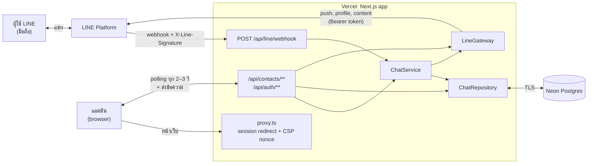
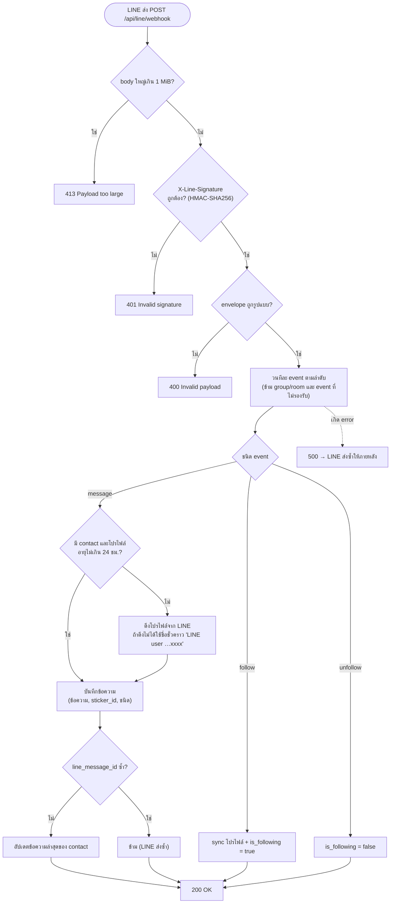
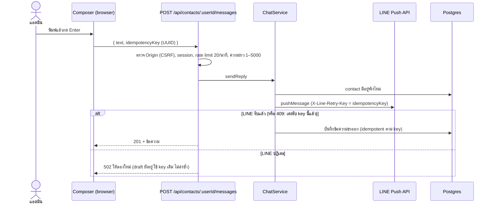
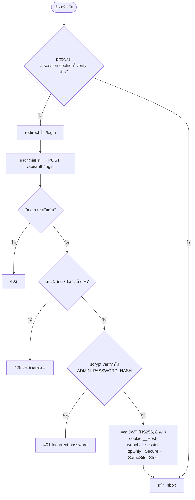
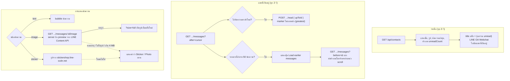
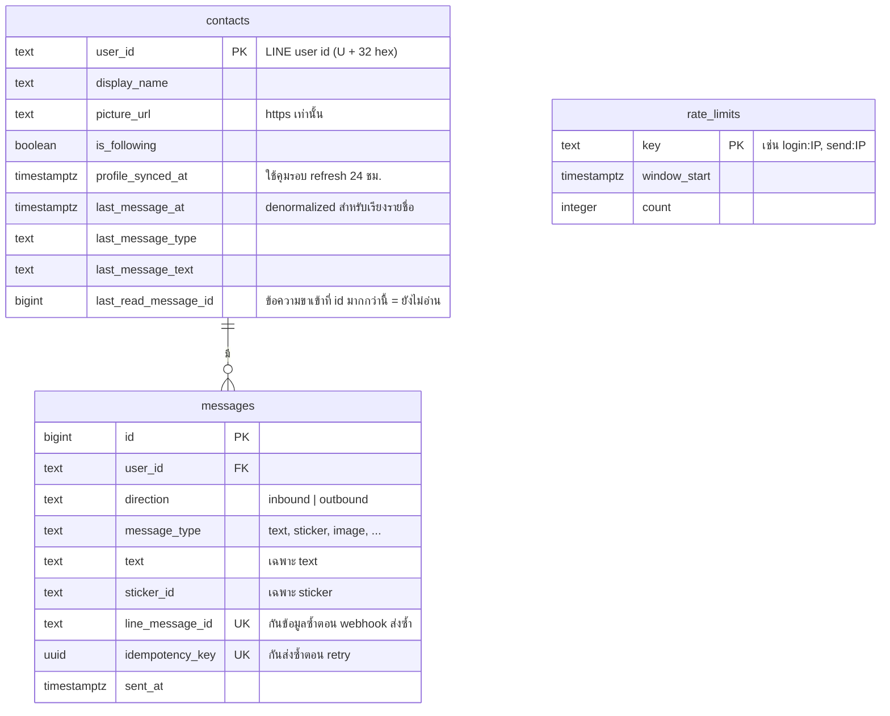

# เอกสารส่งมอบระบบ: LINE OA Webchat

> สถานะ ณ วันที่ 30 ตุลาคม 2026

## 1. ภาพรวม

ระบบเป็นหน้า inbox บนเว็บสำหรับ LINE Official Account (OA)
- ข้อความที่ผู้ใช้ LINE ส่งเข้า OA จะขึ้นในหน้าเว็บ พร้อมชื่อและรูปโปรไฟล์ของผู้ส่ง
- แอดมินเลือกผู้ใช้แล้วพิมพ์ตอบได้ ข้อความจะถูกส่งกลับไปใน LINE ในนามของ OA

| รายการ | ที่อยู่ |
|---|---|
| Webchat (production) | https://webchat-robolingo-sable.vercel.app |
| Repository | https://github.com/matay107/webchat-robolingo |
| LINE OA (เพิ่มเพื่อน) | `https://line.me/R/ti/p/@<basic-id>` (ดู Basic ID ได้ที่ LINE Developers → Messaging API) |
| Webhook URL | `https://webchat-robolingo-sable.vercel.app/api/line/webhook` |
| Hosting | Vercel (region `sin1`) |
| Database | Neon Postgres (เชื่อมผ่าน Vercel Storage) |

**Stack:**
- **Framework:** Next.js 16 (App Router), React 19, TypeScript strict, Node.js 24+
- **ข้อมูล:** Drizzle ORM, Zod, `@line/bot-sdk`
- **UI:** Tailwind CSS 4 ใช้ฟอนต์ Kanit
- **Test:** Vitest, Testing Library, PGlite

## 2. สถานะ: พร้อมใช้งาน

ระบบ deploy อยู่บน production และทำงานครบตามโจทย์

- **ตามโจทย์:** รับข้อความจาก LINE, แสดงตัวตนผู้ใช้ (ชื่อและรูป), เลือกผู้ใช้แล้วตอบกลับ
- **การแสดงข้อความ:**
  - สติกเกอร์แสดงเป็นรูป
  - รูปที่ผู้ใช้ส่งมาแสดงเป็นรูปย่อ กดแล้วเปิดรูปเต็มได้
- **ฟีเจอร์ inbox:**
  - ตัวเลขข้อความยังไม่อ่าน และจำนวนบน title ของแท็บ
  - โหลดข้อความเก่า
- **ความปลอดภัย:**
  - Login ด้วยรหัสผ่านเดียว เก็บเป็น scrypt hash
  - Session แบบ JWT อายุ 8 ชม.
  - Rate limit, กัน CSRF, CSP แบบ nonce
- **Test และ CI:**
  - Test 217 ข้อ เขียนแบบ TDD ทุกฟีเจอร์
  - CI รัน lint, typecheck, test และ `pnpm audit`

ข้อจำกัดที่ทราบอยู่แล้วดูได้ใน[หัวข้อ 11](#11-ข้อจำกัดที่ควรรู้) และแนวทางพัฒนาต่อดูได้ใน[หัวข้อ 12](#12-แนวทางพัฒนาต่อ)

## 3. สถาปัตยกรรม



**ทำไมใช้ polling แทน WebSocket:** Vercel function เป็น serverless จึงเปิด connection ค้างไว้ไม่ได้ หน้าเว็บจึงถามหาข้อมูลใหม่เป็นรอบ
- **ใช้ cursor:** ส่ง `?after=<id ล่าสุด>` ดึงเฉพาะข้อความใหม่
- **ไม่ซ้อนกัน:** รอรอบก่อนเสร็จก่อนเริ่มรอบใหม่
- **หยุดตอนซ่อนแท็บ:** ไม่ยิงคำขอระหว่างที่แอดมินไม่ได้ดูหน้านี้

## 4. Flow การทำงาน

### 4.1 รับข้อความจาก LINE (webhook)



### 4.2 แอดมินตอบข้อความ



### 4.3 Login และ session



**หมายเหตุ:** proxy เป็นแค่ด่านแรกสำหรับหน้าเว็บ ทุก API handler ยังตรวจ session ซ้ำด้วยตัวเอง

### 4.4 หน้า Inbox: polling, ยังไม่อ่าน, ข้อความเก่า, รูป



## 5. โครงสร้างโค้ด

```
src/
  app/                    หน้าเว็บ + route handler บางๆ (แค่เรียก handler)
  proxy.ts                ด่านแรก: redirect ไป /login + สร้าง CSP nonce
  server/
    container.ts          composition root: env → db → service → handlers (สร้างครั้งแรกที่มี request)
    handlers/             webhook.ts, auth.ts, conversations.ts (factory รับ dependency เข้ามา ทำให้ test ได้)
    http.ts               response helper, ตรวจ Origin, ตรวจ session, จำกัดขนาด body
  lib/
    line/                 signature.ts, webhook.ts (parse event), gateway.ts (เรียก LINE API), ids.ts
    chat/                 repository.ts (SQL), service.ts (ingest/reply), types.ts, limits.ts
    auth/                 password.ts (scrypt), session.ts (JWT)
    security/             rate-limiter.ts (fixed window เก็บใน Postgres)
    db/                   schema.ts, client.ts (Neon HTTP สำหรับ *.neon.tech, pg สำหรับที่อื่น)
    env.ts                ตรวจ env ด้วย Zod (error บอกชื่อตัวแปร ไม่บอกค่า)
    logger.ts             log แบบ JSON (ไม่ log ข้อความแชท, token หรือรหัสผ่าน)
  components/
    auth/LoginForm.tsx
    inbox/                Inbox, ContactList, Conversation, MessageThread, Composer, usePolling, api.ts
drizzle/                  migration SQL (0000_init, 0001_sticker_id, 0002_unread)
scripts/hash-password.ts  สร้าง hash รหัสผ่านแอดมิน
test/                     helper: PGlite database, สร้าง request, setup
docs/                     PLAN.md, SECURITY.md, HAND-OFF.md (ไฟล์นี้)
```

## 6. ฐานข้อมูล



## 7. API

ทุก response เป็น JSON และมี `Cache-Control: no-store` ยกเว้น route รูปที่ส่งเป็นไฟล์รูป ส่วน error ใช้รูปแบบ `{ "error": { "code", "message" } }`

| Method & path | การยืนยันตัวตน | หน้าที่ |
|---|---|---|
| `POST /api/line/webhook` | ลายเซ็น LINE | รับ event จาก LINE |
| `POST /api/auth/login` | Origin + rate limit | `{ password }` → ได้ session cookie |
| `POST /api/auth/logout` | Origin | ลบ cookie |
| `GET /api/contacts?limit=` | session | รายชื่อ เรียงตามข้อความล่าสุด พร้อม `unreadCount` |
| `GET /api/contacts/:userId/messages?after=\|before=&limit=` | session | ข้อความเรียงตามเวลา (`after` = polling, `before` = โหลดข้อความเก่า) |
| `POST /api/contacts/:userId/messages` | session + Origin + rate limit | `{ text, idempotencyKey }` → push ไป LINE |
| `POST /api/contacts/:userId/read` | session + Origin | `{ upToId }` → mark ว่าอ่านแล้ว |
| `GET /api/contacts/:userId/messages/:id/image?size=preview\|full` | session | ดึงรูปจาก LINE ผ่าน server (ตรวจว่าข้อความเป็นของ user นั้น) |

## 8. Environment variables

ตั้งใน Vercel → Settings → Environment Variables เป็นชนิด **Secret** สำหรับ Production ส่วนในเครื่องตั้งใน `.env.local`

| ชื่อ | ได้มาจาก |
|---|---|
| `LINE_CHANNEL_SECRET` | LINE Developers → channel → Basic settings |
| `LINE_CHANNEL_ACCESS_TOKEN` | LINE Developers → Messaging API → long-lived token |
| `DATABASE_URL` | Neon connection string (Vercel → Storage) |
| `ADMIN_PASSWORD_HASH` | `pnpm hash-password` (รูปแบบ `scrypt:N=16384,r=8,p=5:<salt>:<hash>`) |
| `SESSION_SECRET` | `openssl rand -base64 48` |

**ทำไม hash ใช้ `:` คั่นแทน `$`:** dotenv ของ Next จะแปลง `$` เป็นการอ้างตัวแปร ถ้าใช้ `$` ค่า hash จะเพี้ยน

## 9. คู่มือการทำงาน

### รันในเครื่อง
ต้องมี Node.js 24+, pnpm และ Docker

```bash
pnpm install
```
```bash
docker compose up -d
```
```bash
cp .env.example .env.local
```
```bash
pnpm db:migrate
```
```bash
pnpm dev
```

**ทดสอบ webhook บนเครื่อง:** ใช้ `ngrok http 3000` แล้วตั้ง URL ที่ได้เป็น webhook ชั่วคราว หรือยิง request ที่เซ็นด้วย `LINE_CHANNEL_SECRET` เองก็ได้

**ข้อควรรู้ตอนใช้ dev mode:** CSP จะบล็อก inline style ของ Next dev overlay แล้วขึ้น error ใน console แต่ production build ไม่มีปัญหานี้ ถ้าต้องการตรวจหน้าตาจริง ให้ใช้ `pnpm build` แล้วตามด้วย `pnpm start`

### ตรวจคุณภาพก่อน commit
```bash
pnpm lint && pnpm typecheck && pnpm test && pnpm build
```

### เปลี่ยน schema ฐานข้อมูล
1. แก้ `src/lib/db/schema.ts`
2. รัน `pnpm db:generate --name <ชื่อ>` จะได้ไฟล์ใหม่ใน `drizzle/`
3. รัน migration กับ **Neon ก่อน** push ทุกครั้ง ไม่อย่างนั้นโค้ดใหม่จะ error ตอนเจอคอลัมน์ที่ยังไม่มี:
```bash
DATABASE_URL='<neon url>' pnpm db:migrate
```
4. push ขึ้น `main` แล้ว Vercel จะ deploy ให้อัตโนมัติ

### Deploy
push ขึ้น `main` แล้ว Vercel จะ build และ deploy ให้เอง ตรวจสถานะได้จาก commit status บน GitHub หรือจาก Vercel → Deployments

**ห้ามใช้ preview URL เป็น webhook:** preview deployment มี Deployment Protection ทำให้ LINE ได้หน้า login แทน ต้องใช้ production domain เท่านั้น

### เปลี่ยนรหัสผ่านแอดมิน
1. รัน `pnpm hash-password` แล้วพิมพ์รหัสใหม่ ยาว 12–128 ตัว (ตอนพิมพ์จอจะไม่แสดงอะไร)
2. ใน Vercel แก้ค่า `ADMIN_PASSWORD_HASH` แล้วกด Redeploy
3. ถ้าต้องการเตะทุก session ออกทันที ให้เปลี่ยน `SESSION_SECRET` ด้วย

### Rotate secret อื่นๆ
| Secret | วิธี |
|---|---|
| LINE channel access token | ออก token ใหม่ใน LINE Developers → แก้ค่าใน Vercel → Redeploy |
| LINE channel secret | Issue ใหม่ใน Basic settings → แก้ค่าใน Vercel → Redeploy (webhook จะ 401 ระหว่างที่ค่าไม่ตรงกัน) |
| Neon password | Neon console → Roles → Reset password → แก้ `DATABASE_URL` ใน Vercel → Redeploy |

## 10. ความปลอดภัย (สรุป)

รายละเอียดเต็มอยู่ใน [SECURITY.md](SECURITY.md) ซึ่ง map กับ OWASP ASVS และ API Security Top 10 2023 ตาม threat model แบบ PTES

| ภัย | ป้องกันด้วย |
|---|---|
| ปลอม webhook | HMAC-SHA256 บน raw body เทียบแบบ constant-time ก่อน parse |
| เดารหัสผ่าน | scrypt + จำกัด 5 ครั้ง / 15 นาที / IP |
| CSRF | cookie `SameSite=Strict` และตรวจ `Origin` ทุก request ที่เปลี่ยนข้อมูล |
| XSS จากชื่อหรือข้อความ | React render เป็นข้อความเท่านั้น + CSP nonce + `strict-dynamic` |
| อ่านรูปหรือข้อความของคนอื่น (BOLA) | query ผูกกับ `userId` ใน path ทุกครั้ง |
| Mass assignment | `z.strictObject` ปฏิเสธ field ที่ไม่รู้จัก |
| Token รั่วไป browser | รูปทุกรูปดึงผ่าน server, ยอมรับเฉพาะ JPEG/PNG/GIF/WebP (ไม่รับ SVG) |
| ใช้ quota LINE หมด | จำกัดการส่ง 20 ครั้ง / นาที / IP |

**ความเสี่ยงที่ยอมรับไว้:**
- **R1:** logout แล้ว JWT ที่ถูกขโมยไปยังใช้ได้จนหมดอายุ
- **R2:** มีรหัสผ่านเดียว ไม่มี MFA
- **R3:** rate limit อิง IP จาก header ที่ Vercel ตั้งให้
- **R4:** ไม่มีงานลบแถว `rate_limits` ที่หมดอายุแล้ว
- **R5:** ข้อความเก็บแบบ plaintext เข้ารหัสแค่ที่ระดับ disk ของ DB

## 11. ข้อจำกัดที่ควรรู้

- **รูปเต็มเกิน 4 MB:** ระบบจะไม่ส่งให้ (404) เพราะ Vercel จำกัด response ไว้ที่ 4.5 MB แต่รูปย่อในแชทยังแสดงได้ปกติ
- **ไฟล์รูปหมดอายุ:** LINE เก็บไฟล์ไว้ระยะหนึ่งเท่านั้น รูปเก่าจะกลับไปแสดงคำว่า "Photo"
- **รูปสติกเกอร์:** ใช้ URL ของ CDN ที่ LINE ไม่ได้รับรองอย่างเป็นทางการ สติกเกอร์บางชุดอาจโหลดไม่ได้ ระบบจะแสดงคำว่า "Sticker" แทน สติกเกอร์ที่รับมาก่อน commit `93ef7ae` ไม่มี `sticker_id` จึงแสดงเป็นคำเสมอ
- **ข้อความชนิดอื่น:** วิดีโอ, เสียง, ไฟล์, ตำแหน่ง แสดงเป็นป้ายชื่อชนิดเท่านั้น
- **แอดมินตอบได้แค่ข้อความ:** ยังส่งรูปหรือสติกเกอร์ไม่ได้
- **รายชื่อแสดง 50 คนล่าสุด:** API รับ `limit` ได้ถึง 100 แต่ยังไม่มีการแบ่งหน้า
- **ความเร็วของ polling:** ข้อความใหม่จะขึ้นภายใน 2–3 วินาที ไม่ใช่ทันที

## 12. แนวทางพัฒนาต่อ

1. E2E test ด้วย Playwright: จำลอง webhook → เห็นในหน้าเว็บ → ตอบกลับ
2. ส่งรูปเต็มแบบ stream เพื่อไม่ติด limit 4 MB
3. แอดมินส่งรูปและสติกเกอร์ได้
4. ข้อความตอบกลับสำเร็จรูปและการค้นหารายชื่อ
5. ระบบหลายแอดมินผ่าน OIDC/SSO พร้อม MFA และเก็บ session ฝั่ง server เพื่อปิดความเสี่ยง R1 และ R2
6. Cron ลบแถว `rate_limits` เก่าเพื่อปิดความเสี่ยง R4
